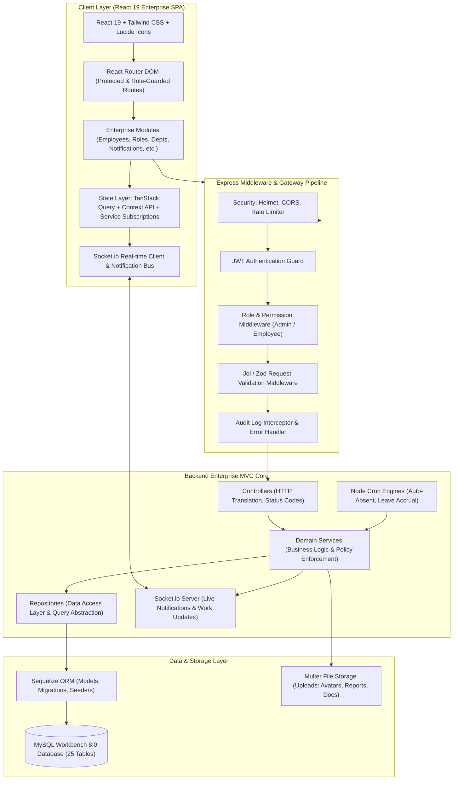
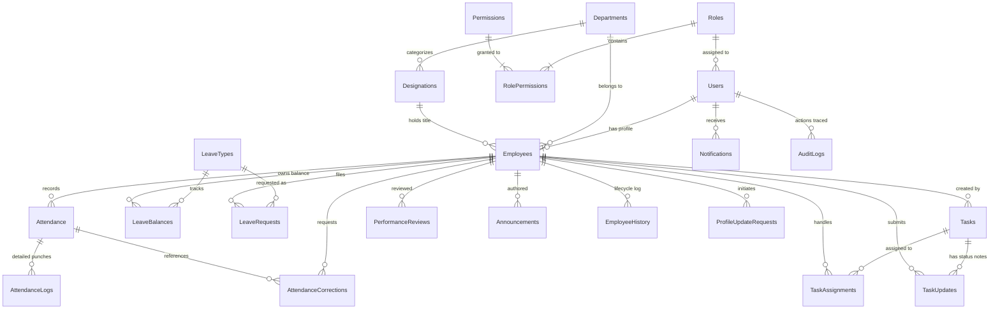
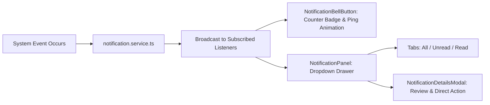

# Enterprise Architecture Blueprint: Production-Ready Employee Management System (EMS)

## Executive Architectural Summary
The **Employee Management System (EMS)** is engineered with an enterprise-grade multi-tier architecture following **Clean Architecture**, **SOLID principles**, and **Domain-Driven Modular Design**. The solution is split into two independent, decoupled projects:

1. **`employee_dashboard-frontend`**: React 19 + TypeScript + Tailwind CSS enterprise SPA with a module-federated modular hierarchy (comparable to Atlassian Jira / Microsoft 365 suites), featuring centralized API abstractions, TanStack Query caching, Lucide iconography, Framer Motion transitions, and React Hook Form validation.
2. **`employee_dashboard-backend`**: Node.js + Express.js + TypeScript enterprise RESTful API adhering strictly to the **Controller-Service-Repository-Model** pattern, Sequelize ORM with MySQL 8.0, Socket.io real-time streaming, Node Cron background scheduling, and rigorous RBAC + Audit Logging.

---

## 1. High-Level System Architecture Diagram



---

## 2. Complete Frontend Structure (`employee_dashboard-frontend`)

```text
employee_dashboard-frontend/
├── public/
│   ├── favicon.ico
│   ├── logo.svg
│   └── robots.txt
├── src/
│   ├── api/
│   │   ├── apiClient.ts
│   │   ├── endpoints.ts
│   │   └── interceptors.ts
│   ├── layouts/
│   │   ├── DashboardLayout/
│   │   │   ├── DashboardLayout.tsx
│   │   │   ├── Header.tsx              # Top bar with Notification Bell & Profile
│   │   │   └── Sidebar.tsx             # Enterprise #1E3A8A Blue Sidebar
│   ├── modules/
│   │   ├── Employee/
│   │   │   ├── components/
│   │   │   │   ├── ActiveFilterChips.tsx       # Live filter tokens & result counter
│   │   │   │   ├── AddEmployeeDrawer.tsx       # Onboarding drawer with validation
│   │   │   │   ├── BreadcrumbFilterTrail.tsx   # Dynamic navigation trail
│   │   │   │   ├── DashboardAccessToggle.tsx   # Real-time login permission toggle
│   │   │   │   ├── DeactivateConfirmationModal.tsx
│   │   │   │   ├── DeleteConfirmationModal.tsx
│   │   │   │   ├── DepartmentBadge.tsx         # Color-coded departmental badge
│   │   │   │   ├── DepartmentFilterDrawer.tsx  # Drawer matrix for division filters
│   │   │   │   ├── DesignationFilterDrawer.tsx # Designation Manager (Add, Edit, Delete, Filter)
│   │   │   │   ├── EditEmployeeDrawer.tsx      # Profile editing drawer
│   │   │   │   ├── EmployeeCard.tsx            # Card grid view
│   │   │   │   ├── EmployeeDetailsDrawer.tsx   # Comprehensive profile view
│   │   │   │   ├── EmployeeFilterBar.tsx       # Advanced search & filter toolbar
│   │   │   │   ├── EmployeeTable.tsx           # Enterprise table with merged Dept & Desig
│   │   │   │   ├── PasswordGeneratorModal.tsx  # Temporary credential generator
│   │   │   │   ├── ResponsiveSummaryCards.tsx  # 4 Interactive top statistic cards
│   │   │   │   └── ToastNotification.tsx
│   │   │   ├── constants/
│   │   │   │   └── employee.constants.ts       # 4 Departments, Seed Staff, Roles
│   │   │   ├── services/
│   │   │   │   ├── designation.service.ts      # Reactive designation management store
│   │   │   │   └── employee.service.ts         # Employee CRUD, status, cascading batch
│   │   │   ├── types/
│   │   │   │   └── employee.types.ts
│   │   │   └── pages/
│   │   │       ├── EmployeeDirectoryPage.tsx
│   │   │       ├── EmployeeProfileViewPage.tsx
│   │   │       └── ManageEmployeesPage.tsx
│   │   ├── RolePermissions/
│   │   │   ├── components/
│   │   │   │   ├── PermissionMatrix.tsx        # Granular read/write toggle grid
│   │   │   │   ├── RoleDetailsDrawer.tsx       # Role inspection drawer
│   │   │   │   ├── CreateEditRoleDrawer.tsx    # Employee role permission manager
│   │   │   │   ├── RolesTable.tsx              # Roles overview with system badges
│   │   │   │   ├── RoleActivityLogs.tsx        # Event timeline of permission updates
│   │   │   │   └── RoleAuditHistory.tsx        # Compliance history table
│   │   │   ├── services/
│   │   │   │   └── rolePermission.service.ts   # RBAC permission rules engine
│   │   │   └── pages/
│   │   │       └── RolePermissionsPage.tsx     # Enterprise 2-role management page
│   │   ├── Departments/
│   │   │   ├── components/
│   │   │   │   ├── DepartmentCardGrid.tsx      # 4 Department cards with status
│   │   │   │   ├── DepartmentTeamLeadsDrawer.tsx# Department leads directory drawer
│   │   │   │   ├── ManageTeamLeadsDrawer.tsx   # Assign/remove department leads
│   │   │   │   ├── DepartmentDetailsDrawer.tsx
│   │   │   │   ├── DepartmentTable.tsx
│   │   │   │   └── EditDepartmentModal.tsx
│   │   │   ├── services/
│   │   │   │   └── department.service.ts
│   │   │   └── pages/
│   │   │       └── DepartmentsPage.tsx
│   │   ├── Notifications/
│   │   │   ├── components/
│   │   │   │   ├── NotificationBellButton.tsx  # Top nav bell with unread badge & animation
│   │   │   │   ├── NotificationPanel.tsx       # 420x600px dropdown panel with tabs
│   │   │   │   ├── NotificationCard.tsx        # Category-themed notification card
│   │   │   │   ├── NotificationDetailsModal.tsx# Actionable notification detail view
│   │   │   │   └── NotificationSettingsModal.tsx# Alert preference toggles
│   │   │   ├── services/
│   │   │   │   └── notification.service.ts     # Real-time event bus & broadcast hub
│   │   │   └── types/
│   │   │       └── notification.types.ts
│   │   ├── Attendance/
│   │   ├── AttendanceCorrection/
│   │   ├── LeaveManagement/
│   │   ├── TaskManagement/
│   │   ├── WorkUpdates/
│   │   ├── Performance/
│   │   ├── Reports/
│   │   └── Settings/
│   ├── styles/
│   │   ├── index.css
│   │   └── tailwind.css
│   ├── App.tsx
│   └── main.tsx
```

---

## 3. Database Schema Design (MySQL 8.0 & Sequelize ORM)



### Table Master Matrix (25 Tables)

| # | Table Name | Key Constraints & Relations | Business Purpose |
|---|------------|-----------------------------|------------------|
| 1 | `Roles` | Strictly 2 Roles: `Admin`, `Employee` | Core RBAC role entities. |
| 2 | `Permissions` | Unique slugs (`employee:create`, `attendance:approve`) | Granular access primitives. |
| 3 | `RolePermissions` | Composite PK (`role_id`, `permission_id`) | Permission assignments. |
| 4 | `Departments` | 4 Authorized: Software Dev, Digital Mktg, Sales, Admin | Master departmental units. |
| 5 | `Designations` | FK `department_id`, Title, Level | Job titles within departments. |
| 6 | `Users` | FK `role_id`, Unique `company_email` | Credentials & authentication. |
| 7 | `Employees` | FK `user_id`, FK `department_id`, FK `designation_id` | Master employee profile record. |
| 8 | `Attendance` | FK `employee_id`, UNIQUE(`employee_id`, `date`) | Daily aggregated attendance. |
| 9 | `AttendanceLogs` | FK `attendance_id`, Punch IN/OUT | Audit trail of raw punch events. |
| 10 | `AttendanceCorrections` | FK `attendance_id`, FK `employee_id` | Regularization workflow queue. |
| 11 | `LeaveTypes` | Casual, Sick, Emergency | Leave category policies. |
| 12 | `LeaveBalances` | FK `employee_id`, FK `leave_type_id` | Running balance ledger. |
| 13 | `LeaveRequests` | FK `employee_id`, FK `actioned_by` | Leave application lifecycle. |
| 14 | `Holidays` | UNIQUE(`date`), Holiday Name | Company holiday calendar. |
| 15 | `CalendarEvents` | FK `department_id`, FK `created_by` | Master scheduling calendar. |
| 16 | `Tasks` | FK `created_by` -> `Users` | Task management master entity. |
| 17 | `TaskAssignments` | FK `task_id`, FK `employee_id` | Eligible role task assignment. |
| 18 | `TaskUpdates` | FK `task_id`, FK `employee_id` | Progress notes & developer updates. |
| 19 | `PerformanceReviews` | FK `employee_id`, FK `reviewer_id` | Appraisal scores & feedback. |
| 20 | `Announcements` | FK `author_id`, FK `target_department_id` | Official company notices. |
| 21 | `Notifications` | FK `user_id`, Priority, Category | Real-time notification store. |
| 22 | `EmployeeHistory` | FK `employee_id`, Event Type, JSON diff | Immutable lifecycle audit trail. |
| 23 | `ProfileUpdateRequests` | FK `employee_id`, Delta JSON | Controlled profile delta queue. |
| 24 | `AuditLogs` | FK `user_id`, IP, Action, Entity | System compliance log. |
| 25 | `Settings` | Key-Value pairs, Type Enums | Dynamic office policy settings. |

---

## 4. Role & Permissions Architecture (RBAC Engine)

### Core Rules
- **Strictly Two Roles**:
  1. **Admin**: Complete system-wide unconstrained authority across every module. Admin permissions cannot be revoked or edited to protect governance integrity.
  2. **Employee**: Access governed entirely by permissions explicitly granted by the Admin.
- **No Super Admin**: Organizational authority rests directly with the Administrator.
- **Permission Matrix**: Organized by modular capabilities:
  - **Employee Management**: `View`, `Create`, `Edit`, `Delete`, `Toggle Access`, `Reset Password`.
  - **Attendance Management**: `View Own`, `View All`, `Punch In/Out`, `Regularization Request`, `Approve Correction`.
  - **Leave Management**: `Apply Leave`, `View Team Leaves`, `Approve/Reject Leave`.
  - **Task Management**: `View Tasks`, `Create Task`, `Assign Task`, `Submit Daily Update`.
  - **Departments & Roles**: `View`, `Manage Team Leads`, `Configure Designations`.
- **Audit & Activity Tracking**: Every permission modification is recorded in `RoleActivityLogs` and `RoleAuditHistory` capturing timestamp, affected role, changed permissions, and Administrator identity.

---

## 5. Organizational Departments & Team Lead Management

### Departmental Rules
- The company operates strictly across **Four Departments**:
  1. `Software Development`
  2. `Digital Marketing`
  3. `Sales`
  4. `Administration`
- **Organizational Constraints**:
  - No separate HR or Finance department (administered under Administration).
  - Graphic Designing is a designation under `Digital Marketing`, not a standalone department.
  - No CEO role exists in the operational tier; system governance is managed by the Admin.

### Team Lead Management Subsystem
- **Team Lead View**: Drawer interface displaying all designated Team Leads for a department with avatar, employee code, name, designation, email, phone, and assignment date.
- **Add Team Lead**:
  - Filtered strictly to Active employees currently belonging to the selected department.
  - Cross-department lead assignments are strictly prohibited.
- **Remove Team Lead**:
  - Interactive removal workflow with explicit confirmation modal.
  - Cascades status and updates employee designation/responsibilities without data loss.

---

## 6. Real-Time Notification Center



- **Top Navigation Trigger**: Bell icon with unread count badge, ping notification animation on arrival, and dropdown toggle.
- **Dropdown Panel**:
  - Dimensions: 420px width $\times$ 600px height with 16px soft rounded corners.
  - Header with unread count, "Mark All as Read", and "Notification Settings".
  - Three filter tabs: `All`, `Unread`, `Read`.
- **Supported Notification Categories**:
  - **Employee**: Onboarding, deactivation, reactivation, dashboard access toggled, password reset.
  - **Attendance**: Punch in/out, late arrival, 11:00 AM auto-absent, attendance correction requests.
  - **Leave**: Requests filed, approvals, rejections, emergency leave alerts.
  - **Tasks**: Task assigned, daily work update submitted, status transitions.
- **Notification Card Design**:
  - Unread items display a blue left accent border (`#2563EB`) and soft blue background.
  - Read items render with neutral clean white card background.
  - Priority indicator tags: `Low`, `Medium`, `High`, `Urgent`.

---

## 7. Dynamic Designation Management & Employee Directory

### Designation Lifecycle Subsystem (`designation.service.ts`)
- **Dynamic Configuration**: Designations are not hardcoded; they are managed dynamically through `designation.service.ts` backed by browser local storage and Sequelize backend synchronization.
- **Add Designation**:
  - Modal form with department selector (`Software Development`, `Digital Marketing`, `Sales`, `Administration`).
  - Validation: Prevents empty titles and duplicate titles within the same department.
- **Inline Rename / Edit**:
  - Pencil icon enables immediate inline title editing directly in the drawer.
  - **Automatic Profile Cascade**: Renaming a designation triggers `employeeService.batchUpdateDesignation(...)`, which atomically updates the title across all employee profiles holding that role and appends a lifecycle entry to their `employmentHistory`.
- **Delete / Remove Designation**:
  - Trash icon opens a guarded confirmation dialog.
  - **Employee Safety Check**: If employees currently hold the designation, the system alerts the admin, calculates the exact headcount, and requires selecting a fallback replacement designation before deletion is executed.
- **Reactive Subscriptions**:
  - `AddEmployeeDrawer`, `EditEmployeeDrawer`, `EmployeeFilterBar`, and `ManageEmployeesPage` subscribe to `designation.service.ts` so all dropdowns reflect title changes instantly without page reloads.

### Employee Directory Table & Layout
- **Responsive Top Summary Cards**:
  - 4 uniform cards: **Total Staff**, **Active**, **Departments**, and **Designations**.
  - Equal height, smooth hover elevation, animated counters, and interactive click-to-filter / click-to-manage capabilities.
- **Merged Department & Designation Column**:
  - In `EmployeeTable.tsx`, Department and Designation are presented in a unified cell: designation title in bold font with the departmental badge pill directly underneath.
- **Removed Status Column**:
  - Table columns streamlined to focus on operational identifiers, contact info, departmental role, employment type, joining date, dashboard access switch, and administrative actions.
- **Breadcrumb Filter Trail & Active Chips**:
  - Real-time feedback bar summarizing the exact count of filtered records (`Showing X matching employees`) with dismissible tokens and "Clear All Filters" shortcut.

---

## 8. Enterprise Design System & Theme Specifications

- **Theme**: Premium Enterprise White Theme.
- **Color Palette**:
  - **Sidebar Background**: `#1E3A8A` (Deep Enterprise Navy)
  - **Sidebar Hover**: `#2563EB` (Royal Blue)
  - **Sidebar Active Menu**: `#DBEAFE` (Soft Ice Blue)
  - **Primary Action Buttons**: `#2563EB`
  - **Success / Active**: `#22C55E`
  - **Warning / Pending**: `#F59E0B`
  - **Danger / Deactivated**: `#EF4444`
  - **Main Background**: `#FFFFFF`
  - **Secondary Surfaces**: `#F8FAFC`
- **Card Styling**: Clean white surfaces, 16px border-radius (`rounded-2xl`), subtle `border-slate-200`, and soft elevation shadows (`shadow-sm` hovering to `shadow-md`).
- **Typography**: Inter font family, high-contrast hierarchy, clean tabular figures for metrics and employee codes.

---

## 9. Verification & Quality Standards

- **TypeScript Compilation**: `npm run build` enforced with `0 errors`.
- **Zero Remote Push Policy**: All development, testing, and persistence remain in local workspace until explicitly approved by the stakeholder.
- **Local Dev Server**: Verified active at `http://127.0.0.1:5173/` returning `HTTP 200 OK`.
